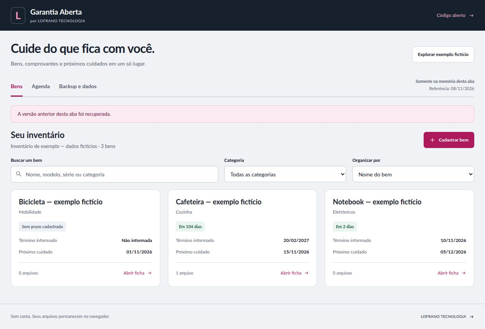

# Garantia Aberta

Um inventário pessoal de bens, comprovantes e manutenções que funciona no navegador. Cadastre o que você possui, guarde uma cópia dos documentos e consulte os prazos que você informou, sem criar conta.

Uma aplicação aberta da [LOFRANO TECNOLOGIA](https://lofranotecnologia.com.br).

[Abrir a aplicação](https://martinlofranodeoliveira.github.io/garantia-aberta/) · [Código no GitHub](https://github.com/martinlofranodeoliveira/garantia-aberta) · [Formato dos dados](docs/FORMATO.md)



## Usar no dia a dia

1. Clique em **Cadastrar bem**, preencha o nome e os detalhes que quiser guardar e escolha **Salvar bem**. Compra e término de garantia são datas opcionais, informadas por você.
2. Na ficha do bem, use **Adicionar arquivo** para guardar comprovantes ou manuais PNG, JPEG ou PDF. Cada arquivo pode ser baixado novamente; não há prévia incorporada.
3. Use **Adicionar manutenção** para registrar uma tarefa e sua data prevista. Ao concluir, informe a data em **Concluída em**. A data prevista permanece no histórico, inclusive em conclusões antecipadas.
4. Busque bens por nome, modelo, série ou categoria. A área **Agenda** reúne as manutenções pendentes em ordem de data. Consulte-a ao abrir a aplicação; não há notificações em segundo plano.
5. Em **Backup e dados**, baixe um **backup completo** antes de fechar uma sessão em memória ou trocar de navegador. Para manter o inventário entre visitas, ative **Salvar inventário neste navegador**.

No primeiro uso, o aplicativo começa vazio. Se houver um inventário salvo neste navegador, ele será recuperado ao abrir a página. **Explorar exemplo fictício** carrega bens e tarefas identificados como fictícios, com datas fixas e sem documentos pessoais. Se já houver bens, a aplicação pede confirmação antes de substituir a versão atual; a última alteração confirmada pode ser desfeita. Baixe um backup antes de explorar o exemplo se já tiver dados próprios.

O prazo exibido é aquele cadastrado por você. O aplicativo não determina a existência, a validade ou a duração de uma garantia legal ou contratual. Confira as condições nos documentos do produto.

## Backup, restauração e salvamento local

O **backup JSON** contém o inventário completo: bens, campos de texto, anexos e manutenções, inclusive as concluídas. Enquanto houver alterações em um formulário, salve ou cancele a edição para trocar de área ou exportar. Alterações não salvas não entram no backup. Guarde o arquivo em um local de sua escolha; ele contém os mesmos dados pessoais e documentos do inventário e não é criptografado.

Para restaurar, escolha **Restaurar backup JSON**. O arquivo inteiro passa por validação de estrutura, limites, bytes e SHA256 dos anexos antes de a aplicação oferecer a confirmação **Substituir inventário**. A restauração substitui a versão atual, sem mesclar registros. Baixe a versão atual antes se quiser preservá-la.

**Exportar lista CSV** gera metadados dos bens e as datas de manutenção para consulta em planilhas. O CSV não inclui os arquivos anexados e não pode restaurar o inventário. Detalhes dos dois formatos estão em [docs/FORMATO.md](docs/FORMATO.md).

Sem o salvamento opcional, os dados ficam na memória da aba e são perdidos ao fechá-la ou recarregá-la. Quando ativado, o aplicativo usa IndexedDB neste perfil de navegador e nesta origem. O status da interface informa se a versão está salva ou permanece apenas em memória. Se ocorrer falta de espaço, indisponibilidade ou conflito, preserve a versão em memória com um backup e siga as opções apresentadas na interface. Prefira uma aba por vez.

O salvamento compara a revisão e grava na mesma transação, impedindo que uma aba sobrescreva silenciosamente a revisão mais recente. Isso não impede que o navegador remova dados por suas políticas de armazenamento, limpeza do perfil ou navegação privada. Um backup fora do navegador continua sendo sua cópia portátil.

Ao desmarcar **Salvar inventário neste navegador**, o aplicativo tenta remover a cópia local daquela revisão e mantém o inventário na memória da aba. Confira a mensagem de resultado: se a remoção não for confirmada ou houver conflito, uma cópia local pode permanecer.

## Limites e privacidade

| Item | Limite |
| --- | --- |
| Bens | 200 por inventário |
| Manutenções | 100 por bem |
| Anexos | PNG, JPEG ou PDF; 5 por bem |
| Tamanho de cada anexo | 2 MiB (2.097.152 bytes) |
| Total dos anexos | 12 MiB (12.582.912 bytes) |
| Backup JSON | 20 MiB (20.971.520 bytes), incluindo Base64 e formatação |

A aplicação não envia inventário ou anexos a um serviço de negócio. Não há sincronização em nuvem, autenticação, OCR, IA ou envio de mensagens. HTML, scripts, estilos e fontes são servidos pelo site; os links externos abrem os destinos indicados.

Os dados locais não são criptografados nem protegidos por uma conta do aplicativo. Pessoas com acesso ao perfil de navegador e outros aplicativos executados na mesma origem podem acessá-los. No GitHub Pages, caminhos diferentes de um mesmo domínio de usuário compartilham a origem; um caminho de projeto não cria isolamento. Para dados sensíveis, considere hospedar sua cópia em uma origem dedicada e controle o acesso ao dispositivo.

A verificação de assinatura básica do tipo de arquivo e de SHA256 detecta certas inconsistências nos anexos. Ela não examina todo o documento, não autentica um comprovante e não é uma análise de malware. Use arquivos de procedência conhecida. Veja [SECURITY.md](SECURITY.md).

## Executar e desenvolver

É necessário Node.js 22 ou superior e npm. Não há dependências de execução no navegador; `linkedom` e `fake-indexeddb` são dependências de desenvolvimento e testes.

```sh
git clone https://github.com/martinlofranodeoliveira/garantia-aberta.git
cd garantia-aberta
npm ci
npm run dev
```

Abra [http://127.0.0.1:4175](http://127.0.0.1:4175). O comando monta `dist/` e serve essa pasta; depois de editar os arquivos, execute o build novamente e recarregue a página. Use o servidor HTTP local ou uma hospedagem HTTPS para as APIs do navegador.

```sh
npm test
npm run build
npm run check
npm run preview
```

`test` executa a suíte Node. `build` gera os arquivos estáticos em `dist/`. `check` verifica a distribuição e os arquivos públicos e deve ser executado depois do build. `preview` serve o build já gerado na porta 4175. Encerre o servidor anterior antes de abrir outro na mesma porta.

## Copiar, adaptar e publicar

Você pode copiar, modificar, usar comercialmente e redistribuir o código sob a [licença MIT](LICENSE), mantendo seu aviso de copyright e licença. Os arquivos de fonte Lato mantêm a licença própria indicada em [THIRD_PARTY_NOTICES.md](THIRD_PARTY_NOTICES.md). Preserve esses avisos ao reutilizar os respectivos arquivos. Identifique sua adaptação e ajuste os links de marca para que sua publicação deixe claro quem a mantém.

Para publicar uma cópia, execute `npm run build` e hospede o conteúdo de `dist/` como site estático. Os caminhos dos recursos são relativos, permitindo servir a aplicação em uma subpasta. Opcionalmente, defina `SITE_URL` como a URL HTTPS pública ao gerar o build para incluir uma URL canônica:

```sh
SITE_URL=https://seu-dominio.example/garantia-aberta/ npm run build
```

O repositório separa o núcleo puro em `src/domain.mjs`, a integridade de anexos em `src/attachments.mjs`, os formatos de exportação em `src/backup.mjs`, o adaptador IndexedDB em `src/storage.mjs` e a interface em `src/app.mjs`. Consulte [o contrato das APIs](docs/API-CONTRACT.md) e [como contribuir](CONTRIBUTING.md) antes de alterar o formato ou o comportamento de salvamento.
